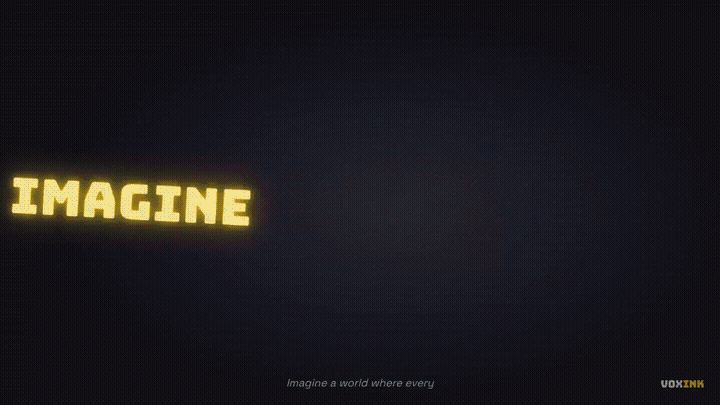
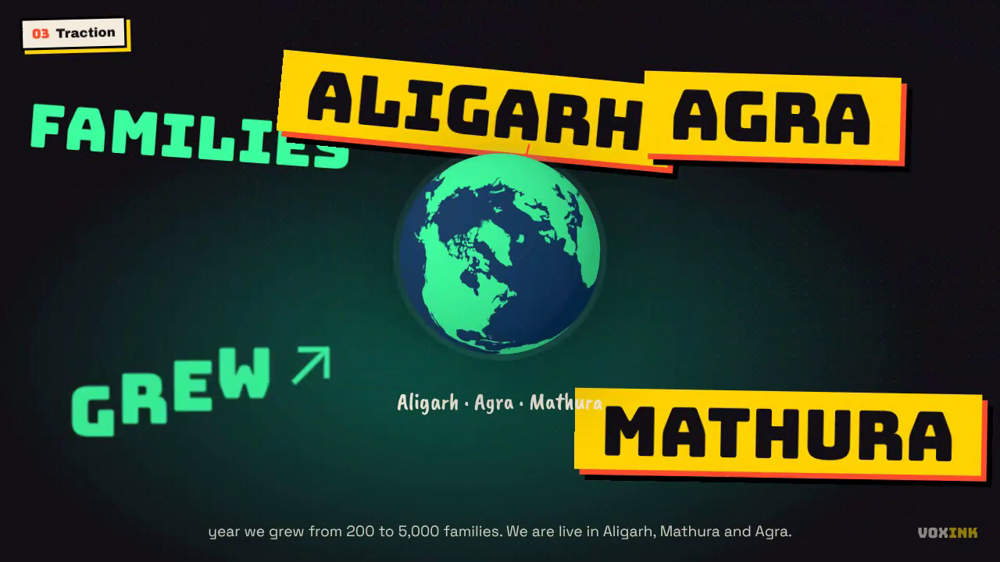
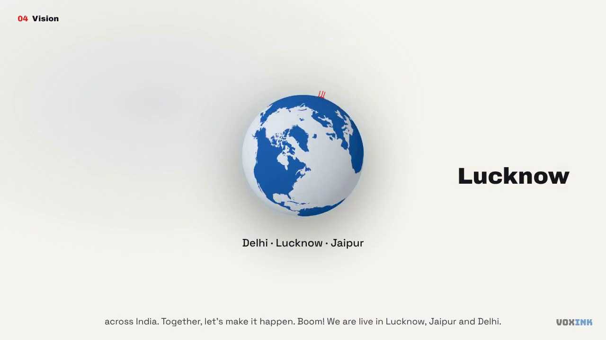
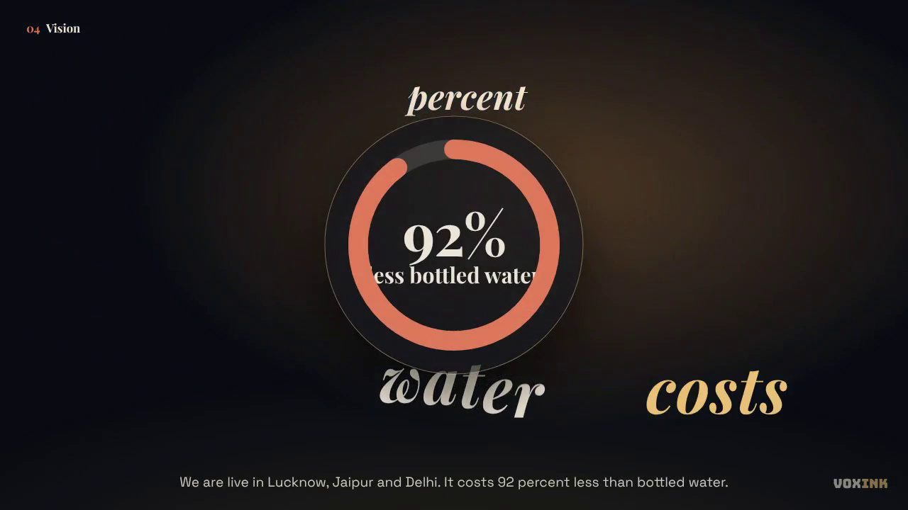
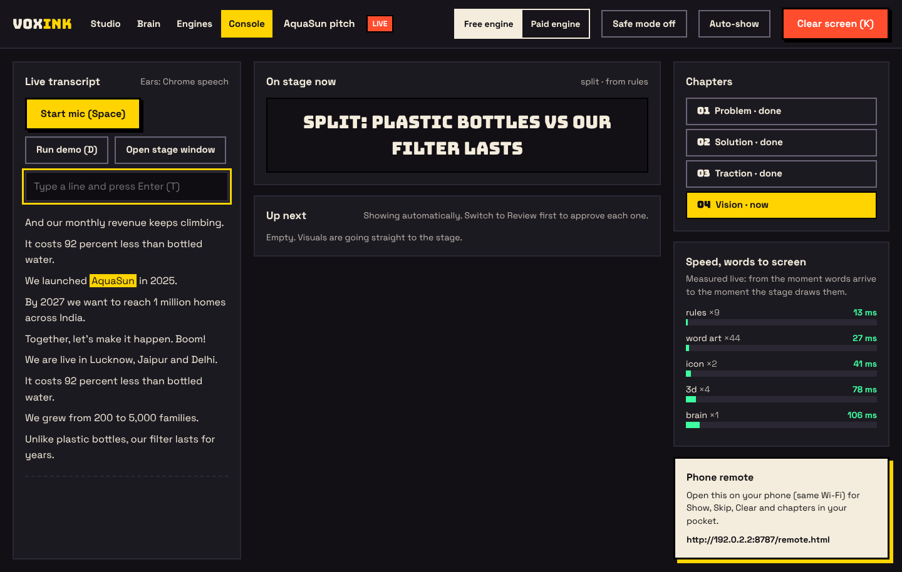
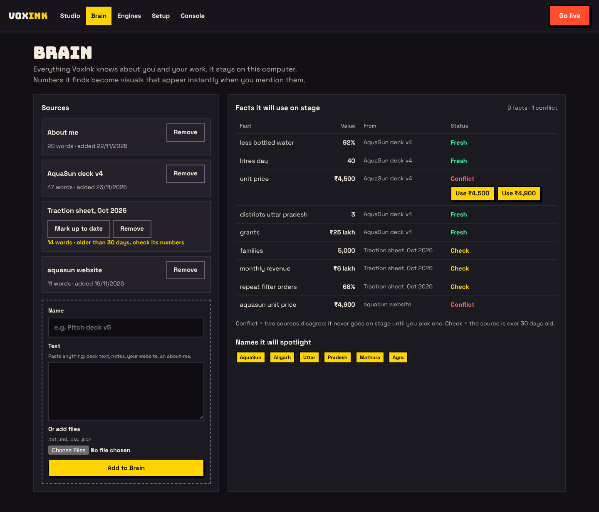
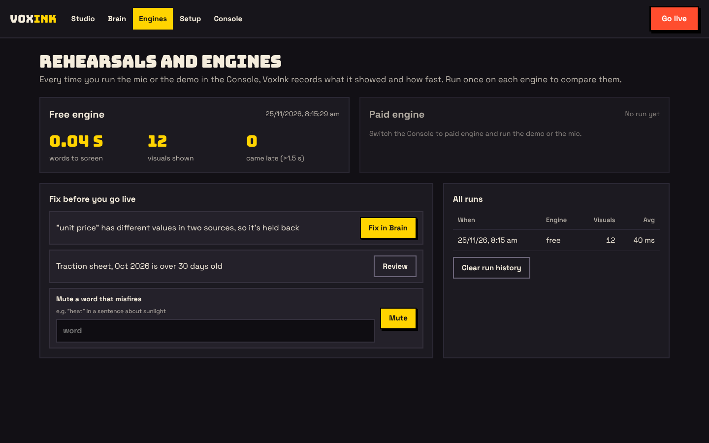
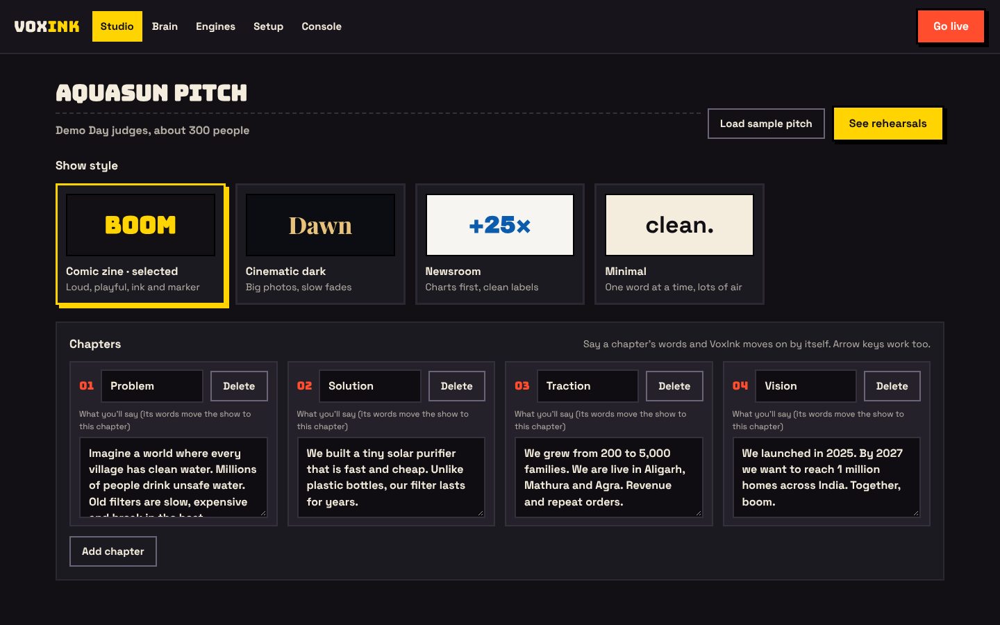
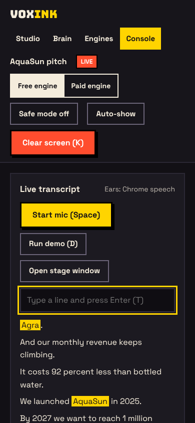
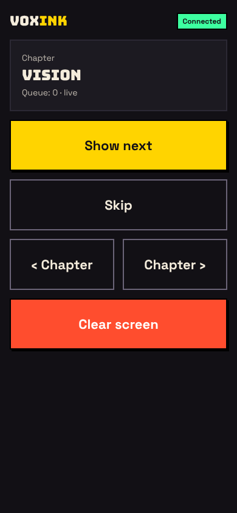

# VoxInk

**Say it, and the screen performs it.** VoxInk is a live motion-graphics director for talks and pitches. It listens while you speak and turns your words into visuals on the big screen as you say them: words that act out their meaning, counters that climb, a real 3D globe with your cities pinned, photos, and comparisons that split the screen. It knows your numbers before you say them.

A [Genzis](mailto:genzis.hq@gmail.com) product · *Generations Ahead*



| Zine | Newsroom | Cinematic |
| --- | --- | --- |
|  |  |  |

---

## Why it's different

Other voice-to-slides tools make **slides**: a title, some bullets, a number. VoxInk makes a **show**:

- **Words act out what they mean.** "Huge" lands huge, "fire" burns, "fast" streaks past, "fall" drops letter by letter, "AI" glitches. That's 24 effects across 220+ trigger words.
- **A Brain that knows your facts.** Paste in your deck, notes or website. VoxInk pulls out every number and name. Say "our monthly revenue keeps climbing" and **₹6 lakh** appears, even though you never said the number.
- **It won't embarrass you.** If two sources disagree (₹4,500 in the deck, ₹4,900 on the website), that number is **held back** until you pick one. Numbers more than 30 days old are flagged for a check.
- **Real visuals, fastest source first:** Brain facts → rule scenes → 1,531 bundled icons → 3D globe → stock photos → AI images (paid).
- **A director's console.** Safe mode, Review-first mode (approve each visual), a big **Clear screen** button, chapters that move on by themselves when you say their words, and measured latency for every visual.
- **A phone remote.** Show, Skip, Clear and chapter controls in your pocket, over your Wi-Fi.
- **Four show styles:** Comic zine, Cinematic dark, Newsroom, Minimal. Switch live.
- **Works offline.** Fonts, icons, world map and rules are all bundled, so venue Wi-Fi can't break the free engine. (Chrome's own speech recognition does need a connection.)

## Quick start

```bash
npm install
npm run dev        # API on :8787, app on http://localhost:5173
```

1. Open **http://localhost:5173**. Studio loads with a sample pitch (AquaSun, a made-up company).
2. Click **Go live** to open the Console, then **Open stage window**. Drag that window to the projector and press **F** for fullscreen.
3. Press **Space** and talk (Chrome or Edge), or press **D** to watch the demo.

Production: `npm run build && npm start` serves everything from one port (8787).

## Free vs paid engine

VoxInk runs fully free with no keys. Each key you add to `.env` turns on one paid part. You can switch engines in the Console, and **Studio › Engines** compares your runs side by side.

| Part | Free | Paid key (`.env`) |
| --- | --- | --- |
| Ears (speech to text) | Chrome / Edge built-in speech | `DEEPGRAM_API_KEY`: Nova-3 streaming, with your Brain's names sent as key terms |
| Director (what to show) | Rules + Brain (offline, under 1 ms) | `LLM_API_KEY` (+ `LLM_BASE_URL`, `LLM_MODEL`): any OpenAI-compatible API, e.g. Groq, Cerebras, Gemini, OpenRouter |
| Photos | Icons + 3D only | `PEXELS_API_KEY`: free key from pexels.com |
| AI images | Off | `FAL_KEY` (+ `IMAGE_MODEL_URL`): fast image model on fal.ai |

Copy `.env.example` to `.env` and fill in only what you want. Keys stay on the server and never reach the browser.

## How it works

```
 mic ─► Ears ─► words ──► Word FX ─────────────────────────────┐
                   │                                           ▼
                   └─► sentence ─► Director ─► cue ─► Console ─► Stage (any window, any device)
                                    ▲    ▲               ▲  ▲
                                 Brain  LLM*     Safe / Review / Clear
                                 (facts, names)   phone remote ─┘
```

- **Console** (`console.html`) is the brain of a live show: it listens, directs, keeps the queue and measures speed.
- **Stage** (`stage.html`) only draws. It reports back when each visual is on screen, which is how latency gets measured for real.
- They talk over **BroadcastChannel** (same computer: zero network, zero latency). A **WebSocket relay** on the server lets a phone remote or a second laptop join.
- **Studio** (`index.html`) holds the talk, chapters, show style, Brain and run history. Everything is stored in your browser.

## Stack

Picked for speed on stage and zero dependencies on venue Wi-Fi:

- **Vite + TypeScript**, no UI framework: the stage is raw DOM plus CSS motion, with `@property`-animated mood light.
- **Three.js** globe painted at runtime from **Natural Earth** land shapes (`world-atlas` + `topojson-client`). It's a real Earth, offline.
- **Phosphor icons** (1,531, bundled as SVG paths) for an instant icon for almost any noun.
- **BM25 retrieval** over your Brain, hand-rolled. It needs no model download and answers in under a millisecond.
- **Hono** server with a `ws` relay, plus a **Deepgram** streaming proxy.
- **Fontsource** self-hosted fonts: Bungee, Rubik Burned/Glitch/Wet Paint, Creepster, Playfair Display, Space Grotesk and more.

## Keyboard

| Console | | Stage | |
| --- | --- | --- | --- |
| Space | mic on/off | F | fullscreen |
| D | run demo | C | captions on/off |
| T | type a line | double-click | fullscreen |
| K | clear screen / bring back | | |
| Enter / Backspace | show / skip next (Review mode) | | |
| ← → | previous / next chapter | | |

## Screens

| Console | Brain | Engines |
| --- | --- | --- |
|  |  |  |

| Studio | Console on a phone | Remote |
| --- | --- | --- |
|  |  |  |

## Project layout

```
index.html  console.html  stage.html  remote.html
server/index.ts          Hono API, WebSocket relay, Deepgram proxy
src/engine/              ears, director, brain, words (FX), icons, geo, globe
src/stage/               the audience screen
src/console/             the presenter's console
src/studio/              talk, Brain, engines, setup
src/remote/              phone remote
src/shared/              bus, store, types, sample pitch, styles, fonts
scripts/build-icons.mjs  rebuilds the bundled icon set
```

## Status and roadmap

Working now: everything above, on the free engine, tested end to end.

The paid parts are written against each provider's documented API but haven't been run with real keys yet. Test them with your own keys before a show.

Next up:
- Hinglish and Hindi word effects
- PDF and PPTX import into the Brain
- Rehearsal "lock the show" mode
- 60-second recap reel export after a talk

## Credits

Icons: [Phosphor](https://phosphoricons.com) (MIT). Map: [Natural Earth](https://www.naturalearthdata.com) via world-atlas (public domain / ISC). Fonts: SIL Open Font License via Fontsource. 3D: three.js (MIT).

© 2026 Genzis. License to be decided.
